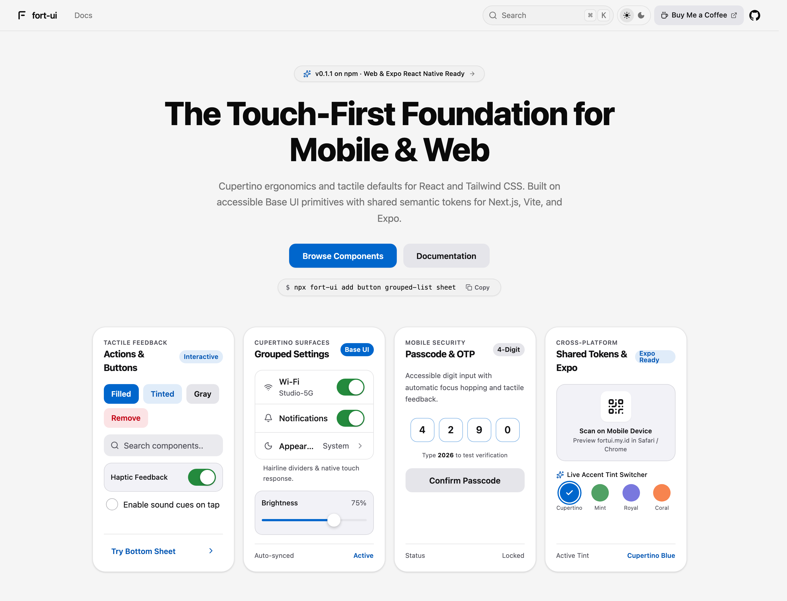
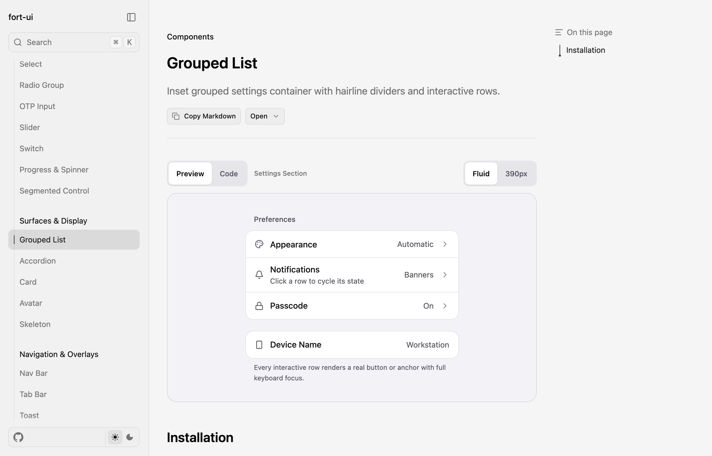

<div align="center">

# fort-ui

Touch-first, Cupertino-inspired copy-paste UI components you own in your repo.<br />
Built for **React + Tailwind CSS** (via Base UI) and **Expo / React Native** with shared semantic tokens.

[](https://fortui.my.id/docs)
[](https://www.npmjs.com/package/fort-ui)
[](https://fortui.my.id/docs)
[](https://saweria.co/sulthonmf)

[Documentation](https://fortui.my.id/docs) · [Components](https://fortui.my.id/docs/components/button) · [Expo Guide](https://fortui.my.id/docs/expo) · [npm Package](https://www.npmjs.com/package/fort-ui) · [Buy Me a Coffee](https://saweria.co/sulthonmf)

</div>

<br />

<a href="https://fortui.my.id">
  <picture>
    <source media="(prefers-color-scheme: dark)" srcset="./public/images/hero-dark.png" />
    
  </picture>
</a>

---

## Why fort-ui?

- **Own the code** — Components are copied directly into your repository (`src/components/ui` or `components/ui`), with zero runtime dependency lock-in.
- **Touch-first ergonomics** — Generous hit targets, hairline dividers, grouped settings surfaces, swipeable drawers, and tactile press states.
- **Web & Expo / React Native** — `fort-ui` automatically detects Next.js / Vite vs Expo / React Native projects and installs the matching implementation using unified semantic tokens.
- **Built on Base UI** — Accessible primitives (`Sheet`, `Select`, `Menu`, `Popover`, `Alert Dialog`, `Switch`, `Slider`, `Radio Group`, `Accordion`, `Toast`) styled with Tailwind CSS v4 tokens.
- **AI-agent friendly** — Browse structured documentation via [`llms.txt`](https://fortui.my.id/llms.txt) or use the **Copy Markdown** button on every docs page.

## Quick Start

Initialize `fort-ui` in your **React Web** or **Expo / React Native** project:

```bash
npx fort-ui init
```

Add the components you need:

```bash
npx fort-ui add button grouped-list switch sheet
```

Or install all available free components in one command:

```bash
npx fort-ui add --all
```

<details>
<summary><strong>More CLI commands (list, Pro auth, custom registry)</strong></summary>

```bash
# List all components supported for your detected project type
npx fort-ui list

# Authenticate once to unlock Pro components (saved to ~/.fort-ui/config.json)
npx fort-ui auth <your-pro-token>

# Install Pro components
npx fort-ui add activity-pill swipe-row

# Check or clear saved credentials
npx fort-ui auth
npx fort-ui auth --clear
```

</details>

## Interactive Preview & Examples

Every component page includes a live interactive preview, a `Fluid` / `390px` viewport switcher, and ready-to-copy TSX snippets.

<a href="https://fortui.my.id/docs/components/grouped-list">
  <picture>
    <source media="(prefers-color-scheme: dark)" srcset="./public/images/docs-preview-dark.png" />
    
  </picture>
</a>

<details>
<summary><strong>React Web Example — Settings Row + Interactive Bottom Sheet</strong></summary>

```tsx
'use client';

import * as React from 'react';
import { Bell, SlidersHorizontal } from 'lucide-react';
import { Button } from '@/components/ui/button';
import { GroupedList, GroupedListItem } from '@/components/ui/grouped-list';
import {
  Sheet,
  SheetClose,
  SheetContent,
  SheetDescription,
  SheetHeader,
  SheetTitle,
  SheetTrigger,
} from '@/components/ui/sheet';
import { Switch } from '@/components/ui/switch';

export function SettingsExample() {
  const [alertsEnabled, setAlertsEnabled] = React.useState(true);

  return (
    <div className="mx-auto max-w-md space-y-4">
      <GroupedList header="Preferences" footer="Updates take effect immediately.">
        <GroupedListItem
          leading={<Bell className="size-4" />}
          title="Notifications"
          subtitle={alertsEnabled ? 'Banners & sounds enabled' : 'Muted'}
          trailing={
            <Switch
              checked={alertsEnabled}
              onCheckedChange={setAlertsEnabled}
            />
          }
        />
        <GroupedListItem
          leading={<SlidersHorizontal className="size-4" />}
          title="Display & Contrast"
          trailing="Automatic"
          chevron
          href="#display"
        />
      </GroupedList>

      <Sheet>
        <SheetTrigger render={<Button variant="tinted" fullWidth>Quick Controls</Button>} />
        <SheetContent>
          <SheetHeader>
            <SheetTitle>Quick Controls</SheetTitle>
            <SheetDescription>
              Swipe down or press Escape to dismiss this sheet.
            </SheetDescription>
          </SheetHeader>
          <SheetClose render={<Button fullWidth>Done</Button>} />
        </SheetContent>
      </Sheet>
    </div>
  );
}
```

</details>

<details>
<summary><strong>Expo / React Native Example — Shared Semantic Tokens & Native Sheet</strong></summary>

```tsx
import * as React from 'react';
import { View } from 'react-native';
import { useFortTheme } from '@/lib/fort-tokens';
import { Button } from '@/components/ui/button';
import { GroupedList, GroupedListItem } from '@/components/ui/grouped-list';
import {
  Sheet,
  SheetClose,
  SheetContent,
  SheetDescription,
  SheetHeader,
  SheetTitle,
  SheetTrigger,
} from '@/components/ui/sheet';
import { Switch } from '@/components/ui/switch';

export function MobileSettingsScreen() {
  const theme = useFortTheme();
  const [notifications, setNotifications] = React.useState(true);

  return (
    <View style={{ flex: 1, backgroundColor: theme.bg, padding: 16, gap: 16 }}>
      <GroupedList header="Preferences" footer="Uses light and dark system tokens.">
        <GroupedListItem
          title="Push Notifications"
          subtitle={notifications ? 'Enabled' : 'Paused'}
          trailing={
            <Switch value={notifications} onValueChange={setNotifications} />
          }
        />
        <GroupedListItem
          title="Appearance"
          trailing="Automatic"
          chevron
          onPress={() => {}}
        />
      </GroupedList>

      <Sheet>
        <SheetTrigger>
          <Button variant="tinted" fullWidth>
            Open Controls
          </Button>
        </SheetTrigger>
        <SheetContent>
          <SheetHeader>
            <SheetTitle>Quick Controls</SheetTitle>
            <SheetDescription>
              Swipe down on the handle to close.
            </SheetDescription>
          </SheetHeader>
          <SheetClose>
            <Button fullWidth>Done</Button>
          </SheetClose>
        </SheetContent>
      </Sheet>
    </View>
  );
}
```

</details>

## Component Catalog

### React Web (30 Components: 28 Free + 2 Pro)

| Category | Components |
| --- | --- |
| **Inputs & Actions** | [`Button`](https://fortui.my.id/docs/components/button) · [`Badge`](https://fortui.my.id/docs/components/badge) · [`Checkbox`](https://fortui.my.id/docs/components/checkbox) · [`Input`](https://fortui.my.id/docs/components/input) · [`Textarea`](https://fortui.my.id/docs/components/textarea) · [`Select`](https://fortui.my.id/docs/components/select) · [`Radio Group`](https://fortui.my.id/docs/components/radio-group) · [`OTP Input`](https://fortui.my.id/docs/components/otp-input) · [`Slider`](https://fortui.my.id/docs/components/slider) · [`Switch`](https://fortui.my.id/docs/components/switch) · [`Progress`](https://fortui.my.id/docs/components/progress) · [`Segmented Control`](https://fortui.my.id/docs/components/segmented-control) · [`Wheel Picker`](https://fortui.my.id/docs/components/wheel-picker) · [`Numpad`](https://fortui.my.id/docs/components/numpad) · [`Filter Chips`](https://fortui.my.id/docs/components/filter-chips) |
| **Surfaces & Display** | [`Grouped List`](https://fortui.my.id/docs/components/grouped-list) · [`Accordion`](https://fortui.my.id/docs/components/accordion) · [`Card`](https://fortui.my.id/docs/components/card) · [`Avatar`](https://fortui.my.id/docs/components/avatar) · [`Skeleton`](https://fortui.my.id/docs/components/skeleton) |
| **Navigation & Overlays** | [`Nav Bar`](https://fortui.my.id/docs/components/nav-bar) · [`Tab Bar`](https://fortui.my.id/docs/components/tab-bar) · [`Toast`](https://fortui.my.id/docs/components/toast) · [`Menu`](https://fortui.my.id/docs/components/menu) · [`Popover`](https://fortui.my.id/docs/components/popover) · [`Alert Dialog`](https://fortui.my.id/docs/components/alert-dialog) · [`Sheet`](https://fortui.my.id/docs/components/sheet) · [`Action Sheet`](https://fortui.my.id/docs/components/action-sheet) |
| **Pro Registry** | [`Activity Pill`](https://fortui.my.id/docs/components/activity-pill) · [`Swipe Row`](https://fortui.my.id/docs/components/swipe-row) |

### Expo / React Native (`tokens` + 17 Components)

| Target | Registry Items |
| --- | --- |
| **Semantic Tokens** | [`tokens`](https://fortui.my.id/docs/expo) (`light` / `dark` color tokens + `useFortTheme()` + `hairline`) |
| **Native UI** | `action-sheet` · `alert-dialog` · `avatar` · `badge` · `button` · `card` · `checkbox` · `filter-chips` · `grouped-list` · `input` · `numpad` · `progress` · `segmented-control` · `sheet` · `switch` · `tab-bar` · `wheel-picker` |

## Support

If `fort-ui` saves you time in shipping mobile-first React or Expo interfaces, consider buying me a coffee on Saweria:

[](https://saweria.co/sulthonmf)

---

<details>
<summary><strong>Local Development & Repository Structure</strong></summary>

### Scripts

- `npm run dev` — Start the Next.js + Fumadocs development server (`http://localhost:3000`)
- `npm run registry:build` — Build `registry.json` (`public/r/`), `registry.pro.json` (`server/r/pro/`), and `registry.native.json` (`public/r/native/`)
- `npm run fort-ui -- <cmd>` — Run the local `fort-ui` CLI (`init`, `add`, `list`, `auth`)
- `npm run cli:test` — Run CLI integration tests (Web, Pro API auth, Expo) and native TypeScript checks
- `npm run types:check` — Run `next typegen` and TypeScript typechecking
- `npm run build` — Rebuild registries and build the production Next.js bundle

### Directory Layout

- `registry/web/ui/` — 27 Web component source files (25 Free + 2 Pro)
- `registry/native/` — Expo / React Native semantic tokens and 14 core native components
- `app/api/r/pro/` — Metadata catalog and token-protected Pro component download endpoints
- `packages/cli/` — `fort-ui` CLI npm package (`init`, `add`, `list`, `auth`)
- `lib/pro-registry.mjs` — Bearer token verification and allowlisted Pro payload loader
- `lib/shared.ts` — App config, repository metadata, and donation link (`donateConfig.url`)
- `content/docs/` — Fumadocs MDX documentation pages
- `components/` — Documentation preview helpers and interactive demos

</details>

## License & Notice

MIT License. `fort-ui` is an independent project and is not affiliated with or endorsed by Apple Inc.
